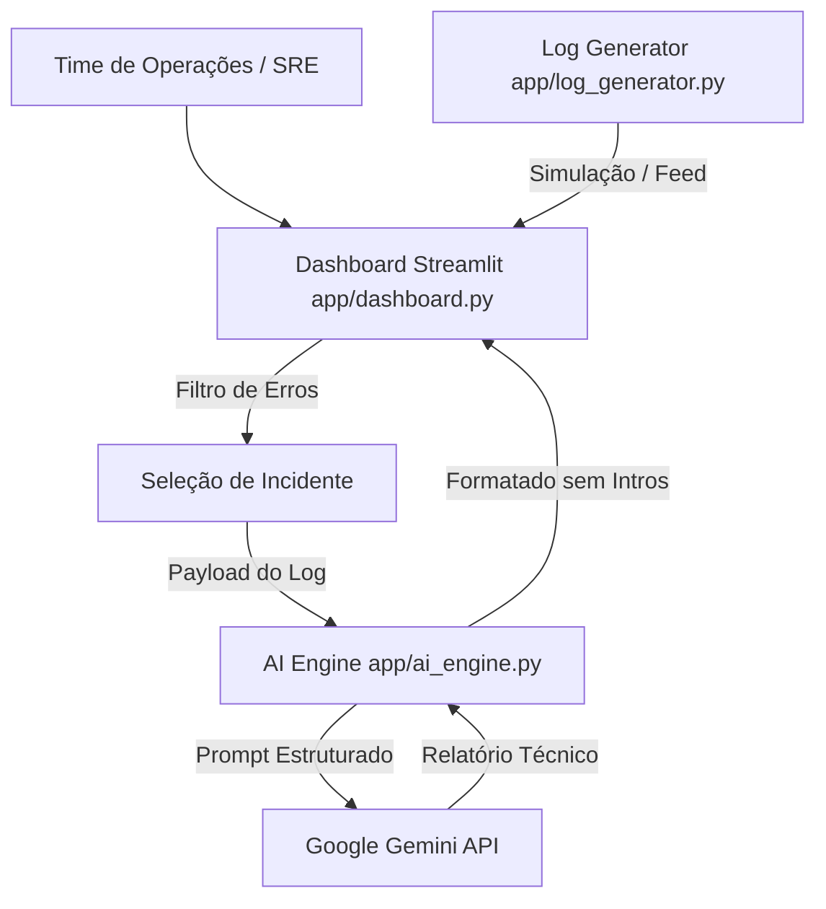

# 🛡️ AI Log & Incident Analyzer

> Plataforma de monitoramento de logs de infraestrutura com ingestão em tempo real, métricas interativas e diagnóstico automático por IA.

**🔗 Demo online:** [ai-log-analyzer.streamlit.app](https://ai-log-analyzer-hh3n92pf4rns5v7fqcwsgq.streamlit.app/)  

---

## 📌 Sobre o Projeto

Equipes de infraestrutura e SRE gastam um tempo precioso realizando triagem manual de logs para identificar *o que quebrou, por quê e como corrigir*. 

O **AI Log Analyzer** simula um ambiente de AIOps de ponta a ponta:
1. **Ingere e monitora logs** de serviços de produção em tempo real (simulando falhas em SAP, PostgreSQL, Kubernetes e VPNs);
2. **Exibe métricas de saúde** em um dashboard visual dinâmico com taxas de erro e gráficos de volume por serviço;
3. **Processa incidentes críticos** enviando o payload do log para um motor de IA (**Google Gemini**) com regras rígidas de formatação técnica;
4. **Gera relatórios de triagem** instantâneos contendo a Causa Raiz Provável, Nível de Severidade e as Ações de Mitigação Recomendados.

---

## ✨ Funcionalidades

- **Métricas Globais em Tempo Real:** Total de eventos, quantidade de erros, taxa de erro (%) e status operacional do sistema (OPERACIONAL / CRÍTICO).
- **Feed de Ingestão Dinâmico:** Tabela interativa que exibe eventos por timestamp, nível (`INFO`, `WARN`, `ERROR`), serviço afetado e mensagem.
- **Simulador de Tráfego:** Botão para geração de eventos pontuais e chave (*toggle*) para ingestão contínua a cada 2 segundos.
- **Gráficos por Serviço e Nível:** Visualização interativa (Plotly) para identificar gargalos e serviços instáveis.
- **Engine de IA (AIOps):** Diagnóstico automático de incidentes selecionados, com plano de ação direto sem introduções conversacionais.
- **Fallback Automático de Modelo:** Tratamento de indisponibilidade (erros HTTP 503) com retries e fallback transparente do `gemini-3.5-flash-lite` para o `gemini-3.1-flash-lite`.
- **Seleção de Ambiente Target:** Alternância de contexto entre ambientes (`PRD-Cluster-01`, `QAS-Environment`, `DEV-Local`).

---

## 🏗️ Arquitetura do Sistema



---

## 🧰 Stack Tecnológica

| Camada | Tecnologia |
|---|---|
| **Linguagem** | Python |
| **Interface / Dashboard** | Streamlit |
| **Data & Visualização** | Pandas, Plotly |
| **Engine de IA** | Google GenAI SDK (`gemini-3.5-flash-lite` / `gemini-3.1-flash-lite`) |
| **Gerenciamento de Segredos** | Python-dotenv (Local) / Streamlit Secrets (Nuvem) |
| **Containerização** | Docker, Podman |
| **Orquestração** | Kubernetes (Manifestos Deployment & Service em `k8s/`) |

---

## 🚀 Como Executar o Projeto Localmente

### 1. Pré-requisitos
- Python 3.10 ou superior instalado
- Uma chave de API gratuita do Google Gemini ([obtenha no Google AI Studio](https://aistudio.google.com/))

### 2. Passo a Passo

```bash
# 1. Clonar o repositório
git clone https://github.com/pietrobatistela/ai-log-analyzer.git
cd ai-log-analyzer

# 2. Criar e ativar o ambiente virtual
python -m venv .venv

# No Windows (PowerShell):
.\.venv\Scripts\Activate.ps1
# No Linux/macOS:
source .venv/bin/activate

# 3. Instalar dependências
pip install -r requirements.txt

# 4. Configurar a variável de ambiente
# Crie um arquivo .env na raiz do projeto contendo:
# GEMINI_API_KEY="sua_chave_do_gemini_aqui"

# 5. Iniciar o Dashboard Streamlit
streamlit run app/dashboard.py
```

O dashboard estará disponível no seu navegador no endereço: **`http://localhost:8501`**.

---

## 🐳 Execução em Containers & Kubernetes

### Docker
```bash
docker build -t ai-log-analyzer .
docker run -d -p 8501:8501 -e GEMINI_API_KEY=$GEMINI_API_KEY --name aiops-app ai-log-analyzer
```

### Podman
```bash
podman build -t ai-log-analyzer .
podman run -d -p 8501:8501 -e GEMINI_API_KEY=$GEMINI_API_KEY --name aiops-app ai-log-analyzer
```

### Kubernetes (Minikube / kind)
```bash
# Criar o Secret com a credencial
kubectl create secret generic gemini-api-key --from-literal=GEMINI_API_KEY=$GEMINI_API_KEY

# Aplicar os manifestos
kubectl apply -f k8s/

# Redirecionar a porta para acesso local
kubectl port-forward svc/ai-log-analyzer 8501:8501
```

---

## 📁 Estrutura do Repositório

```text
.
├── app/
│   ├── __init__.py
│   ├── log_generator.py   # Gerador sintético de logs de tráfego e falhas
│   ├── ai_engine.py       # Integração modular com Gemini SDK, retries e prompts
│   └── dashboard.py       # Interface gráfica e gráficos ao vivo em Streamlit
├── k8s/                   # Manifestos de Deployment e Service Kubernetes
├── Dockerfile             # Containerização da aplicação
├── requirements.txt       # Dependências Python (streamlit, genai, pandas, plotly)
├── .env                   # Variáveis de ambiente (ignorado no Git)
└── README.md
```

---

## 🧠 Decisões Técnicas

- **Separação de Módulos:** Desacoplamento entre geração de tráfego (`log_generator.py`), inteligência artificial (`ai_engine.py`) e visualização (`dashboard.py`), facilitando a substituição do Gemini por outros provedores.
- **Prompt Engineering Restritivo:** Forçamento de regras no prompt para eliminar frases irrelevantes e iniciar a saída diretamente na causa raiz, tornando os relatórios objetivos para operação.
- **Resiliência a Falhas de API:** Tratamento de exceções HTTP 503 (superlotação temporária) com lógica de tentativa em loop e fallback de modelo.
- **Gestão Segura de Chaves:** Uso de `python-dotenv` em ambiente local e compatibilidade com `st.secrets` (formato TOML) para hospedagem segura no Streamlit Cloud.

---

## ⚠️ Limitações Conhecidas

- **Dados em Memória:** Os logs são mantidos na sessão do Streamlit (`st.session_state`) e resetam ao recarregar a página.
- **Validação Humana:** O diagnóstico gerado por IA serve como suporte à decisão de N1/N2/SRE e não deve substituir validação humana prévia em ambientes críticos.

---

## 🗺️ Próximos Passos

- [ ] Detecção estatística de anomalias com **Scikit-Learn (`IsolationForest`)** antes da chamada do LLM
- [ ] Ingestão contínua via **Redis Streams** ou **Apache Kafka**
- [ ] Persistência de incidentes em banco relacional (PostgreSQL / SQLite)

---

## 👤 Autor

**Pietro Martins Batistela**  
[GitHub](https://github.com/pietrobatistela)